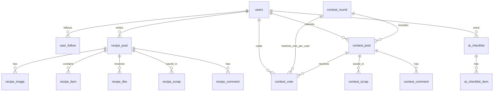

# To-Be ERD & Index Schema (PostgreSQL 16 + pgvector)

> **확정 정책**: `DEC-003` (PostgreSQL 16 + pgvector 단일 DB), `DEC-004` (콘테스트 회차당 1인 1표)

---

## 1. 핵심 관계 요약 (Mermaid ER Diagram)

---

## 2. 도메인별 테이블 및 인덱스 명세

### 2-1. 회원 · 인증 · 팔로우 (`Auth & Social`)

#### `users`
| 컬럼 | 타입 | 제약 | 설명 |
| :--- | :--- | :--- | :--- |
| `id` | `BIGSERIAL` | `PK` | 회원 ID |
| `email` | `VARCHAR(100)` | `NOT NULL` | 이메일 |
| `password` | `VARCHAR(255)` | `NULL` | BCrypt 해시 (소셜 가입 시 NULL) |
| `nickname` | `VARCHAR(30)` | `NOT NULL, UNIQUE` | 닉네임 |
| `profile_image_url` | `VARCHAR(500)` | `NULL` | 프로필 이미지 URL |
| `bio` | `VARCHAR(200)` | `NULL` | 한줄 소개 |
| `provider` | `VARCHAR(20)` | `NOT NULL` | `LOCAL`, `KAKAO`, `GOOGLE` |
| `provider_id` | `VARCHAR(100)` | `NULL` | OAuth2 식별자 |
| `role` | `VARCHAR(20)` | `NOT NULL` | `USER`, `ADMIN` |
| `follower_count` | `INTEGER` | `NOT NULL DEFAULT 0` | 팔로워 수 캐시 |
| `following_count` | `INTEGER` | `NOT NULL DEFAULT 0` | 팔로잉 수 캐시 |
| `deleted_at` | `TIMESTAMPTZ` | `NULL` | Soft Delete |
| `created_at` / `updated_at` | `TIMESTAMPTZ` | `NOT NULL` | 생성/수정 일시 |

- **인덱스**:
  - `UNIQUE (email, provider)` — 동일 이메일의 로컬/소셜 구분 또는 통합 정책 지원
  - `UNIQUE (provider, provider_id) WHERE provider_id IS NOT NULL` — OAuth2 로그인 고속 조회

#### `user_follow`
- **컬럼**: `id (PK)`, `follower_id (FK -> users.id)`, `following_id (FK -> users.id)`, `created_at`
- **제약/인덱스**:
  - `UNIQUE (follower_id, following_id)` — 중복 팔로우 방지
  - `CHECK (follower_id <> following_id)` — 자기 자신 팔로우 방지
  - `INDEX (follower_id, created_at DESC)` — 내 팔로잉 목록 조회
  - `INDEX (following_id, created_at DESC)` — 내 팔로워 목록 조회

---

### 2-2. 조건별 인테리어 레시피 커뮤니티 (`Recipe`)

#### `recipe_post`
| 컬럼 | 타입 | 제약 | 설명 |
| :--- | :--- | :--- | :--- |
| `id` | `BIGSERIAL` | `PK` | 레시피 ID |
| `user_id` | `BIGINT` | `FK -> users.id, NOT NULL` | 작성자 |
| `title` | `VARCHAR(120)` | `NOT NULL` | 제목 |
| `content` | `TEXT` | `NOT NULL` | 본문 (마크다운/텍스트) |
| `housing_type` | `VARCHAR(30)` | `NOT NULL` | `ONE_ROOM`, `TWO_ROOM`, `OFFICETEL`, `APARTMENT` |
| `area_pyeong` | `SMALLINT` | `NOT NULL` | 평수 |
| `contract_type` | `VARCHAR(20)` | `NOT NULL` | `JEONSE`, `MONTHLY`, `OWNED` |
| `is_no_drill` | `BOOLEAN` | `NOT NULL` | 무타공 여부 |
| `budget` | `INTEGER` | `NOT NULL` | 총 예산 (원 단위) |
| `style_tag` | `VARCHAR(30)` | `NOT NULL` | 스타일 (`MODERN`, `WOOD`, `MINIMAL` 등) |
| `thumbnail_url` | `VARCHAR(500)` | `NULL` | 대표 이미지 URL |
| `like_count` / `scrap_count` / `view_count` | `INTEGER` | `NOT NULL DEFAULT 0` | 집계 카운트 |
| `deleted_at` | `TIMESTAMPTZ` | `NULL` | Soft Delete |
| `created_at` / `updated_at` | `TIMESTAMPTZ` | `NOT NULL` | 생성/수정 일시 |

- **튜닝 인덱스**:
  - `INDEX (housing_type, is_no_drill, budget, created_at DESC)` — 복합 조건 필터링 + 최신순 정렬 Filesort 최소화
  - `INDEX (id DESC) WHERE deleted_at IS NULL` — No-Offset (Keyset) 페이징 지원

#### `recipe_image` / `recipe_item`
- `recipe_image`: `id`, `post_id (FK)`, `image_url`, `sort_order`
- `recipe_item`: `id`, `post_id (FK)`, `item_name`, `category`, `price`, `purchase_note` (RAG 예산 배분표 근거 데이터)

#### `recipe_like` / `recipe_scrap`
- 공통 컬럼: `id`, `post_id (FK)`, `user_id (FK)`, `created_at`
- **인덱스**:
  - `UNIQUE (post_id, user_id)` — 중복 좋아요/스크랩 원천 차단
  - `INDEX (user_id, created_at DESC)` — 마이페이지 내가 좋아요/스크랩한 글 고속 조회

#### `recipe_comment`
- 컬럼: `id`, `post_id (FK)`, `user_id (FK)`, `parent_id (FK -> recipe_comment.id, NULL)`, `content`, `deleted_at`, `created_at`
- **인덱스**: `INDEX (post_id, parent_id, created_at ASC)`

---

### 2-3. 주간 인테리어 콘테스트 (`Contest`)

#### `contest_round`
- 컬럼: `id (PK)`, `round_no (UNIQUE)`, `title`, `theme_description`, `status` (`UPCOMING` / `ACTIVE` / `CLOSED`), `start_at`, `end_at`, `created_at`

#### `contest_post`
- 컬럼: `id (PK)`, `round_id (FK)`, `user_id (FK)`, `title`, `content`, `thumbnail_url`, `vote_count (DEFAULT 0)`, `scrap_count (DEFAULT 0)`, `final_rank (NULL)`, `created_at`
- **제약/인덱스**:
  - `UNIQUE (round_id, user_id)` — 회차당 1인 1출품 제한
  - `INDEX (round_id, vote_count DESC)` — 마감 후 랭킹/명예의 전당 조회

#### `contest_vote`
- 컬럼: `id (PK)`, `round_id (FK)`, `contest_post_id (FK)`, `user_id (FK)`, `created_at`
- **제약/인덱스**:
  - **`UNIQUE (round_id, user_id)`** — **`DEC-004` 회차당 1인 1표 DB 레벨 원천 차단**
  - `INDEX (contest_post_id)` — 출품작별 득표 집계 보조

#### `contest_scrap`
- 컬럼: `id (PK)`, `contest_post_id (FK)`, `user_id (FK)`, `created_at`
- **제약/인덱스**:
  - `UNIQUE (contest_post_id, user_id)` — 중복 북마크 방지
  - `INDEX (user_id, created_at DESC)` — 마이페이지 내가 북마크한 콘테스트 출품작 조회

#### `contest_comment`
- 컬럼: `id (PK)`, `contest_post_id (FK)`, `user_id (FK)`, `parent_id (NULL)`, `content`, `deleted_at`, `created_at`

---

### 2-4. 인테리어 가이드 & AI RAG (`Guide & RAG`)

#### `interior_guide`
- 컬럼: `id (PK)`, `title`, `category` (`STYLE` / `NO_DRILL` / `LIGHTING` / `STORAGE`), `style_tag`, `content`, `color_palette`, `created_at`, `updated_at`

#### `rag_document_chunk`
| 컬럼 | 타입 | 제약 | 설명 |
| :--- | :--- | :--- | :--- |
| `id` | `BIGSERIAL` | `PK` | 청크 ID |
| `source_type` | `VARCHAR(20)` | `NOT NULL` | `RECIPE`, `GUIDE`, `CONTEST` |
| `source_id` | `BIGINT` | `NOT NULL` | 원본 게시글/가이드 ID |
| `chunk_index` | `INTEGER` | `NOT NULL` | 문서 내 청크 순서 |
| `content` | `TEXT` | `NOT NULL` | 메타데이터 Prefix 포함 청크 본문 |
| `metadata` | `JSONB` | `NOT NULL` | `housing_type`, `budget`, `is_no_drill` 등 |
| `embedding` | `vector(1536)` | `NOT NULL` | 임베딩 벡터 (모델 차원에 맞춰 고정) |
| `updated_at` | `TIMESTAMPTZ` | `NOT NULL` | 최종 임베딩 시각 |

- **튜닝 인덱스**:
  - `CREATE INDEX idx_rag_chunk_embedding_hnsw ON rag_document_chunk USING hnsw (embedding vector_cosine_ops);`
  - `INDEX (source_type, source_id)` — 원본 수정/삭제 시 기존 청크 일괄 삭제·갱신 고속화
  - `GIN INDEX (metadata)` — JSONB 메타데이터 필터링 보조

---

### 2-5. AI 체크리스트 보관함 (`AI Checklist`)

#### `ai_checklist`
- 컬럼: `id (PK)`, `user_id (FK -> users.id)`, `title`, `query_summary`, `target_budget`, `housing_type`, `is_no_drill`, `created_at`
- **인덱스**: `INDEX (user_id, created_at DESC)`

#### `ai_checklist_item`
- 컬럼: `id (PK)`, `checklist_id (FK -> ai_checklist.id)`, `step_order`, `category`, `content`, `estimated_cost`, `is_checked (DEFAULT false)`, `memo`
- **인덱스**: `INDEX (checklist_id, step_order ASC)`
