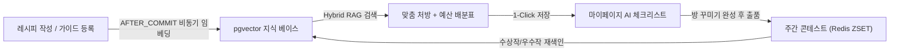

# Domain & User Flow — Roomora

## 1. 서비스 핵심 순환 구조 (Core Flywheel)

---

## 2. 5대 핵심 도메인 흐름

### Flow A. 회원 · OAuth2 간편가입 · 인증 흐름
1. **일반 가입**: 이메일·닉네임 중복 검증 → `BCrypt` 암호화 → `users` (`provider=LOCAL`) 저장
2. **소셜 로그인 (Kakao / Google)**: OAuth2 Authorization Code 수신 → `(provider, provider_id)`로 활성 회원(`deleted_at IS NULL`) 조회 → 미가입 시 추가 프로필(닉네임) 입력 후 가입 완료
3. **토큰 발급 & 회전**: Access Token(응답) + Refresh Token(Redis 저장) 발급, 재발급 요청 시 **Refresh Token Rotation** 적용(탈취·재사용 탐지 시 전체 세션 무효화)
4. **API 인가**: JWT 필터가 `@AuthenticationPrincipal`에 인증 주체 주입 (`@RequestHeader("userId")` 방식 완전 제거)

---

### Flow B. 레시피 작성 → 비동기 RAG 인덱싱 흐름
1. **이미지 업로드**: 프론트가 S3/R2 Presigned URL 발급 요청 → 스토리지에 직접 업로드 → 반환된 URL만 백엔드에 전달
2. **레시피 저장**: `recipe_post` (주거형태·평수·계약형태·예산·무타공 메타데이터) + `recipe_image` + `recipe_item` 단일 트랜잭션 저장
3. **비동기 인덱싱 (장애 격리)**:
   - 트랜잭션 커밋 이후(`@TransactionalEventListener(phase = AFTER_COMMIT)`) 이벤트 발행
   - 비동기 워커가 메타데이터 Prefix(`[원룸 | 6평 | 전세 | 무타공 | 50만원]`)를 붙여 청킹·임베딩 후 `rag_document_chunk`에 Upsert (`UNIQUE(source_type, source_id, chunk_index)`)
   - 외부 임베딩 API 장애 시에도 **레시피 작성 자체는 절대 실패하지 않음**

---

### Flow C. AI RAG 통합 검색 → 체크리스트 1-Click 저장 흐름
1. **방어선 (Rate Limit & Cache)**: Redis에서 사용자/IP별 일일 AI 호출 한도 확인 → 동일 질의 캐시 Hit 시 즉시 반환
2. **Query Understanding**: 자연어에서 정형 조건(`예산 <= 500000`, `무타공 = true`)과 의미 검색어 분리
3. **Single-DB Hybrid Search**: PostgreSQL에서 정형 조건 **Pre-filtering** 후 `pg_trgm` 키워드 + `pgvector` HNSW 코사인 유사도 결합(RRF)으로 Top-K 청크 조회
4. **Structured Output & Fallback**:
   - 정상 시: `Spring AI`가 **교차 조합 처방(Citation) · 현실 예산 배분표 · 체크리스트 초안 · 주의 경고**를 JSON으로 반환
   - 장애/타임아웃 시: **Resilience4j Circuit Breaker**가 RDB 조건 필터 + 키워드 검색 결과로 우회(`Fallback`) 반환
5. **체크리스트 저장**: 유저가 *"내 체크리스트로 저장"* 클릭 시 `ai_checklist` + `ai_checklist_item` 저장 → 마이페이지에서 진행률 관리

---

### Flow D. 주간 콘테스트 출품 → 투표(동시성) → 마감 배치 흐름
1. **출품**: `ACTIVE` 상태인 `contest_round` 검증 → `contest_post` (`UNIQUE(round_id, user_id)` 1인 1출품) + `contest_image` 다중 이미지 저장
2. **투표 & 실시간 랭킹**:
   - `contest_vote`에 `UNIQUE(round_id, user_id)`로 회차당 1인 1표(`DEC-004`) 강제 + 동시성 제어
   - 투표 성공 시 **Redis ZSET** (`contest:ranking:{roundId}`) 점수 즉시 반영 → 실시간 Top N 조회
3. **마감 배치**: 회차 종료 시각 도래 시 스케줄러가 회차 상태를 `CLOSED`로 전환하고 Redis ZSET 최종 순위를 `contest_post.final_rank`에 영구 확정 저장

---

### Flow E. 커뮤니티 상호작용 & 마이페이지 소셜 흐름
- **상호작용**: 레시피 좋아요(`recipe_like`), 레시피 북마크(`recipe_scrap`), 콘테스트 북마크(`contest_scrap`), 2-Depth 댓글/대댓글, 유저 팔로우(`user_follow`)
- **마이페이지 모아보기**: 내 프로필·팔로워/팔로잉 목록, 내가 쓴 레시피·출품작·댓글, 내가 좋아요/북마크한 글, **내 AI 체크리스트 보관함** 통합 조회
